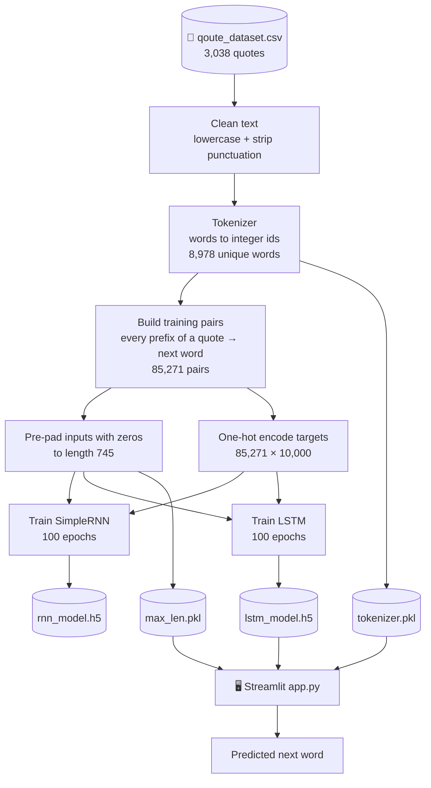
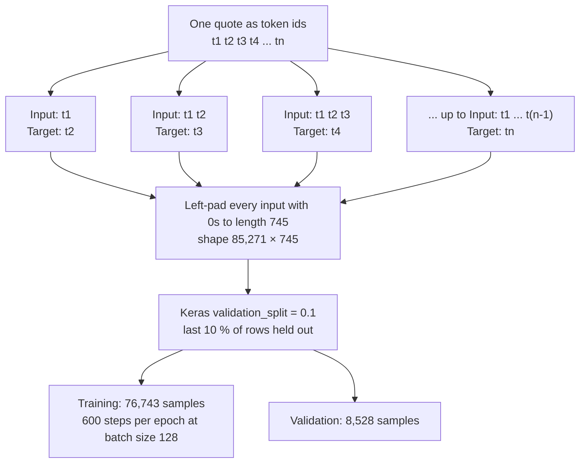
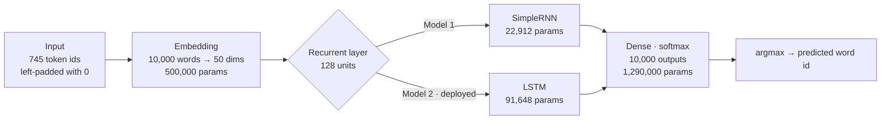
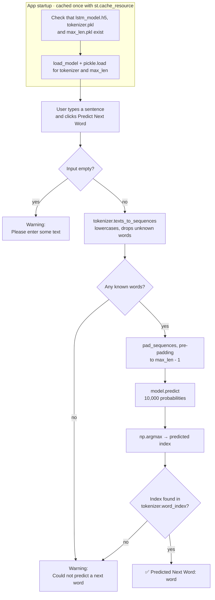
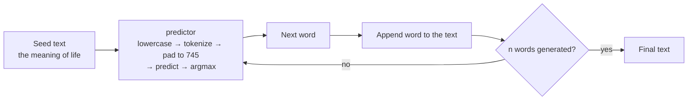

# 🧠 Next Word Prediction with RNN & LSTM

A deep-learning project that predicts the **next word** of a sentence. It trains a **SimpleRNN** and an **LSTM** on a corpus of 3,038 quotes, compares them, and serves the LSTM through a small **Streamlit** web app.


---

## 📑 Table of Contents

1. [Overview & Results at a Glance](#-overview--results-at-a-glance)
2. [Project Structure](#-project-structure)
3. [End-to-End Pipeline (Diagram)](#-end-to-end-pipeline)
4. [Dataset](#-dataset)
5. [Turning Quotes into Training Data (Diagram)](#-turning-quotes-into-training-data)
6. [Model Architecture (Diagram)](#-model-architecture)
7. [Training & Results](#-training--results)
8. [How the Web App Works (Diagram)](#-how-the-web-app-works)
9. [Generating Longer Text (Diagram)](#-generating-longer-text)
10. [Getting Started](#-getting-started)
11. [Known Limitations & Next Steps](#-known-limitations--next-steps)
12. [Author](#-author)

---

## 🏁 Overview & Results at a Glance

Given a prefix such as `what are you`, the model outputs the single most likely next word. It is framed as **multi-class classification**: every word in the vocabulary (8,978 words) is a class.

| | SimpleRNN | LSTM (used by the app) |
|---|:---:|:---:|
| Architecture | Embedding → SimpleRNN(128) → Dense(10,000) | Embedding → LSTM(128) → Dense(10,000) |
| Parameters (computed) | 1,812,912 | 1,881,648 |
| Train accuracy, epoch 100 | 72.6 % | 73.0 % |
| **Validation accuracy, epoch 100** | **7.1 %** | **7.6 %** |
| Best validation accuracy | 11.3 % (epoch 8) | 11.2 % (epoch 20) |
| Validation loss, epoch 100 | 10.89 | 11.69 |

For reference, always guessing the most frequent word (`the`) scores about **3.6 %** on the same validation rows.

> ⚠️ **Key takeaway:** both models **memorize** the training quotes (73 % train accuracy) but generalize modestly (≈ 7–11 % validation accuracy). The saved models are the epoch-100 versions, i.e. the most overfit ones. See [Training & Results](#-training--results) and [Known Limitations](#-known-limitations--next-steps).

---

## 🗂 Project Structure

```text
next-word-prediction/
├── app.py                 # Streamlit web app (loads the LSTM and predicts)
├── model.ipynb            # Main notebook: preprocessing → training RNN & LSTM → saving → text generation
├── trail.ipynb            # Small side experiment: SimpleRNN sentiment classifier on 30 toy sentences
├── qoute_dataset.csv      # Dataset: 3,038 quotes with their authors
├── lstm_model.h5          # Trained LSTM (22.6 MB), used by app.py
├── rnn_model.h5           # Trained SimpleRNN (21.8 MB), kept for comparison
├── tokenizer.pkl          # Fitted Keras Tokenizer (8,978 words)
├── max_len.pkl            # Stored integer 745: the padded input length used in training
├── assets/
│   └── training_curves.png
└── README.md
```

Auto-generated items you can ignore or git-ignore: `.ipynb_checkpoints/` (notebook autosaves, including an earlier draft of `model.ipynb`) and `.vscode/settings.json` (editor setting).

---

## 🔄 End-to-End Pipeline



**Reading the diagram**

| Stage | What happens | Why it matters |
|-------|--------------|----------------|
| **Clean** | Quotes are lowercased and ASCII punctuation (`string.punctuation`) is removed. | Reduces the vocabulary: `Life` and `life.` become the same word. |
| **Tokenize** | Keras `Tokenizer(num_words=10000)` assigns each word an integer id, most frequent first (`the` = 1, `you` = 2, …). | Neural networks work on numbers, not strings. |
| **Build pairs** | Each quote is expanded into many *(prefix → next word)* examples. | Turns 3,038 quotes into 85,271 training samples. |
| **Pad** | Every prefix is left-padded with zeros to a fixed length of 745. | Batches need equal length. Left-padding keeps the real words next to the final time step the network reads. |
| **One-hot** | Each target word becomes a 10,000-long vector with a single 1. | Required by `categorical_crossentropy`. |
| **Train two models** | The same data trains a SimpleRNN and an LSTM with identical settings. | A fair like-for-like comparison. |
| **Save artifacts** | Model, tokenizer and `max_len` are saved to disk. | The app needs all three to turn raw text into a prediction. |

---

## 📊 Dataset

`qoute_dataset.csv` (the file name is spelled this way in the repo and in the code) contains famous quotes.

| Column | Description |
|--------|-------------|
| `quote` | The quote text (wrapped in curly quotation marks) |
| `Author` | Who said it (**not used** for training) |

| Statistic | Value |
|-----------|-------|
| Rows | 3,038, with no missing values |
| Quote length | mean ≈ 29 words, median 18, 75 % ≤ 29, maximum 746 |
| Unique words after tokenizing | 8,978 |
| Vocabulary cap (`num_words`) | 10,000 (so no word is dropped) |

The very long outlier (746 words) is what pushes the padded input length up to **745**, even though most quotes are far shorter.

---

## ✂️ Turning Quotes into Training Data

A language model needs to see a sentence *grow* one word at a time. Each quote is therefore sliced into every prefix, with the following word as the label.



**Worked example** — the first quote in the dataset becomes 21 tokens, which yields 20 training pairs:

| Pair | Input prefix | Token ids | Target |
|:----:|--------------|-----------|--------|
| 1 | `“the` | `[713]` | `world` (62) |
| 2 | `“the world` | `[713, 62]` | `as` (29) |
| 3 | `“the world as` | `[713, 62, 29]` | `we` (19) |
| 4 | `“the world as we` | `[713, 62, 29, 19]` | `have` (16) |
| … | … | … | … |
| 20 | `“the world … changing our` | `[713, 62, …, 70]` | `thinking”` (2461) |

Every input is then left-padded to 745 values, for example `[0, 0, …, 0, 713, 62]` for pair 2.

**Reading the diagram**

- A quote with *n* tokens contributes *n − 1* pairs, so 3,038 quotes produce **85,271** pairs in total.
- Keras takes the **last 10 %** of the arrays for validation *before* shuffling, which is why the validation set is 8,528 rows and training uses 76,743 (= 600 steps × 128).
- Because the rows are ordered quote by quote, those held-out rows come from the last quotes in the file. The validation score therefore measures performance on mostly *unseen quotes*, not on prefixes of quotes the model has already seen.

---

## 🧠 Model Architecture



```python
embedding_dim = 50
rnn_units     = 128

lstm_model = Sequential([
    Embedding(input_dim=10000, output_dim=embedding_dim),
    LSTM(units=rnn_units),
    Dense(units=10000, activation='softmax')
])
lstm_model.compile(optimizer='adam',
                   loss='categorical_crossentropy',
                   metrics=['accuracy'])
```

The SimpleRNN model is identical except `SimpleRNN(units=128)` replaces `LSTM(units=128)`.

**Reading the diagram**

| Layer | Output | Parameters | Role |
|-------|--------|:----------:|------|
| Embedding | 745 × 50 | 10,000 × 50 = **500,000** | Gives each word id a learned 50-number vector, so similar words can end up close together. |
| SimpleRNN *or* LSTM | 128 | RNN: 50×128 + 128×128 + 128 = **22,912**<br/>LSTM: 4 × 22,912 = **91,648** | Reads the sequence word by word and compresses it into one 128-number summary. The LSTM has four gated transformations, hence 4× the weights, which helps it keep information over long sequences. |
| Dense + softmax | 10,000 | 128 × 10,000 + 10,000 = **1,290,000** | Turns the summary into a probability for every vocabulary slot. |
| **Total** | | RNN **1,812,912** · LSTM **1,881,648** | |

*(The notebook never printed a built `summary()`, so these counts are computed from the layer sizes. They are consistent with the roughly 22 MB `.h5` files, which also store optimizer state.)*

**Things worth knowing**

- About **69 %** of the LSTM's parameters sit in the output layer, because it must score 10,000 classes.
- The tokenizer only produces ids 1–8,978 (0 is padding), so about **1,022 output units can never be a valid word**. They simply learn to stay near zero.
- `max_len` is the length of the longest *input prefix* (745).

---

## 📈 Training & Results

Both models used identical settings: Adam optimizer, categorical cross-entropy, batch size 128, 100 epochs, 10 % validation split.

<p align="center">
  
</p>

*Re-plotted from the per-epoch values logged in `model.ipynb`. Dashed lines are validation; the dotted line is the "always predict the" baseline.*

| Epoch | RNN train acc. | RNN val. acc. | LSTM train acc. | LSTM val. acc. |
|:-----:|:--------------:|:-------------:|:---------------:|:--------------:|
| 1 | 4.6 % | 6.0 % | 3.9 % | 4.6 % |
| 10 | 20.9 % | 10.7 % | 15.0 % | 11.1 % |
| 20 | 39.3 % | 9.2 % | 26.4 % | 11.2 % |
| 50 | 62.4 % | 7.6 % | 52.6 % | 8.9 % |
| 100 | 72.6 % | 7.1 % | 73.0 % | 7.6 % |

**Interpretation**

- **Classic overfitting.** Training accuracy climbs to about 73 %, while validation accuracy peaks early (epoch 8 for the RNN, epoch 20 for the LSTM at about 11 %) and then *drifts down*. Validation loss is lowest at epoch 3 (RNN, 6.30) and epoch 5 (LSTM, 6.41), then rises above 10.
- **The models beat the trivial baseline, but not by much.** Even the final 7–8 % is above the 3.6 % "always predict `the`" baseline. A corpus of about 3,000 quotes is small for a 9,000-word vocabulary, and many different continuations are equally valid, which caps achievable top-1 accuracy.
- **LSTM vs SimpleRNN.** Final numbers are close. The LSTM's training curve is smoother, while the SimpleRNN's shows visible dips (for example near epochs 70, 81 and 97).
- **The saved models are the epoch-100 ones.** No early stopping or checkpointing was used, so the deployed LSTM is more overfit than its best epoch.

### Example outputs (LSTM, from `model.ipynb`)

| Seed text | Output |
|-----------|--------|
| `what are you` (next word) | `implying` |
| `the meaning of life` (+10 words, greedy) | `the meaning of life is not in love it is not madness it is` |

Output is fluent-sounding but not meaningful, which is expected from a small model trained for next-word prediction only.

---

## 🖥 How the Web App Works

`app.py` is a single-file Streamlit app. It loads the LSTM, the tokenizer and `max_len` once, then predicts a word whenever the button is clicked.



**Reading the diagram**

1. **Startup.** `load_resources()` is wrapped in `@st.cache_resource`, so the 22 MB model is loaded once per server process, not on every click. If a file is missing, the app shows an error and stops (`st.stop()`).
2. **Input checks.** An empty box gives a warning. Text with *no* known words (every word out-of-vocabulary) also gives a warning, because the tokenizer silently drops unknown words and nothing is left to feed the model.
3. **Prediction.** The text is converted to ids, padded, and passed through the LSTM. The word with the highest probability (`argmax`) is looked up and shown.
4. **Edge case.** If the model picks index 0 or one of the unused output slots, no word exists for it and the "could not predict" warning is shown.

---

## 🔁 Generating Longer Text

`model.ipynb` also contains a small **autoregressive generator**: predict one word, append it to the text, and repeat.



**Reading the diagram:** each prediction becomes part of the next input, so mistakes compound. Because the choice is always the *single most likely* word (greedy decoding), the text tends to loop on common phrases such as `it is not … it is`. Sampling with a temperature or top-k would give more varied output.

---

## 🚀 Getting Started

### Prerequisites

- Python 3.11 (used for development)
- TensorFlow with Keras 3 (the models were saved with it, so load them with a matching version)

### Installation

```bash
# 1. Clone the repository
git clone https://github.com/Ayush-aw4/next-word-prediction.git
cd next-word-prediction

# 2. (Recommended) create a virtual environment
python -m venv venv
source venv/bin/activate          # Windows: venv\Scripts\activate

# 3. Install dependencies
pip install tensorflow streamlit numpy pandas matplotlib seaborn jupyter
```

### Run the web app

```bash
streamlit run app.py
```

Open the local URL Streamlit prints (usually `http://localhost:8501`), type a sentence and click **Predict Next Word**. The three files `lstm_model.h5`, `tokenizer.pkl` and `max_len.pkl` must sit next to `app.py`.

### Retrain the models

```bash
jupyter notebook model.ipynb      # then: Kernel → Restart & Run All
```

Plan for the following:

- **Memory:** the one-hot target matrix (85,271 × 10,000 floats) alone needs about **3.4 GB** of RAM, plus about 250 MB for the padded inputs.
- **Time:** the logged runs took roughly 20–45 seconds per epoch, so about 35 to 75 minutes per model for 100 epochs on CPU.
- **Output:** the last cells overwrite `lstm_model.h5`, `rnn_model.h5`, `tokenizer.pkl` and `max_len.pkl`.

### Notebook walkthrough

| File | Contents |
|------|----------|
| `model.ipynb` | Load data → clean → tokenize → build pairs → pad → one-hot → train RNN and LSTM → save artifacts → `predictor()` and `generate_text()` demos |
| `trail.ipynb` | A separate warm-up: a 30-sentence positive/negative sentiment classifier (Embedding → SimpleRNN(8) → sigmoid, 32,209 parameters, 25 epochs). It is not used by the app. |

---

## 🔧 Known Limitations & Next Steps

**Worth fixing first**

- [ ] **Padding length mismatch in `app.py`.** The app pads to `max_len - 1` (744), but the model was trained on inputs of length `max_len` (745), and the notebook's `predictor()` uses 745. Depending on the Keras version this can raise a shape error or give misaligned input. Use `maxlen=max_len` in `app.py`. *(I could not run the app in my environment, so I haven't confirmed which symptom you'd see.)*
- [ ] **Curly quotes leak into the vocabulary.** `string.punctuation` only removes ASCII punctuation, so the `“` and `”` around each quote stay attached to the first and last word. The result: `“the` (id 713) and `the` (id 1) are different tokens, as are `thinking”` (2461) and `thinking` (293). In total **242 vocabulary entries contain curly quotes or apostrophes**. Normalize `“ ” ‘ ’` before tokenizing, and reuse the *same* cleaning function in `app.py`.
- [ ] **Cleaning differs between training and the app.** Training strips all ASCII punctuation (so `don't` becomes `dont`), while the app relies only on the tokenizer's default filters, which keep the apostrophe. A typed `don't` is therefore an unknown word and is silently dropped. Share one preprocessing function between notebook and app.
- [ ] **Overfitting.** Add `EarlyStopping(restore_best_weights=True)` (validation loss bottoms out around epoch 3–5), `Dropout`, and/or fewer epochs, and save the best epoch rather than epoch 100.

**Efficiency**

- [ ] **Use `sparse_categorical_crossentropy` with integer targets** instead of one-hot encoding. This removes the 3.4 GB target matrix.
- [ ] **Cap the input length** (for example 30–50 tokens, keeping the most recent words). One 746-word quote forces all 85,271 inputs to length 745, while 75 % of quotes have 29 words or fewer. Adding `mask_zero=True` to the Embedding (as `trail.ipynb` already does) also lets the recurrent layer skip padding.
- [ ] **Add an `<OOV>` token** (`Tokenizer(oov_token="<OOV>")`) so unknown words are kept as a placeholder instead of being dropped.

**Ideas to extend the project**

- [ ] Show the **top-3 / top-5 predictions with probabilities** in the app instead of one word.
- [ ] Use **sampling with temperature** for text generation instead of greedy `argmax`.
- [ ] Fix `generate_text = generate_text(...)` in the notebook: it overwrites the function with its own result, so the cell fails if run twice.
- [ ] Evaluate with **top-k accuracy and perplexity**, which suit language models better than top-1 accuracy.
- [ ] Try a **Bidirectional or stacked LSTM/GRU**, pretrained embeddings (GloVe), or a larger corpus.
- [ ] Switch from legacy `.h5` to the native `.keras` format, add a `requirements.txt` with pinned versions and a `.gitignore` for `.ipynb_checkpoints/`.
- [ ] Consider Git LFS or a GitHub Release for the two ~22 MB model files. `rnn_model.h5` is not used by the app.
- [ ] Rename `qoute_dataset.csv` to `quote_dataset.csv` (update the path in the notebook).

---

## 👤 Author

**Ayush Shriram Awchar**
GitHub: [@Ayush-aw4](https://github.com/Ayush-aw4)

If this project helped you, consider giving it a ⭐.
